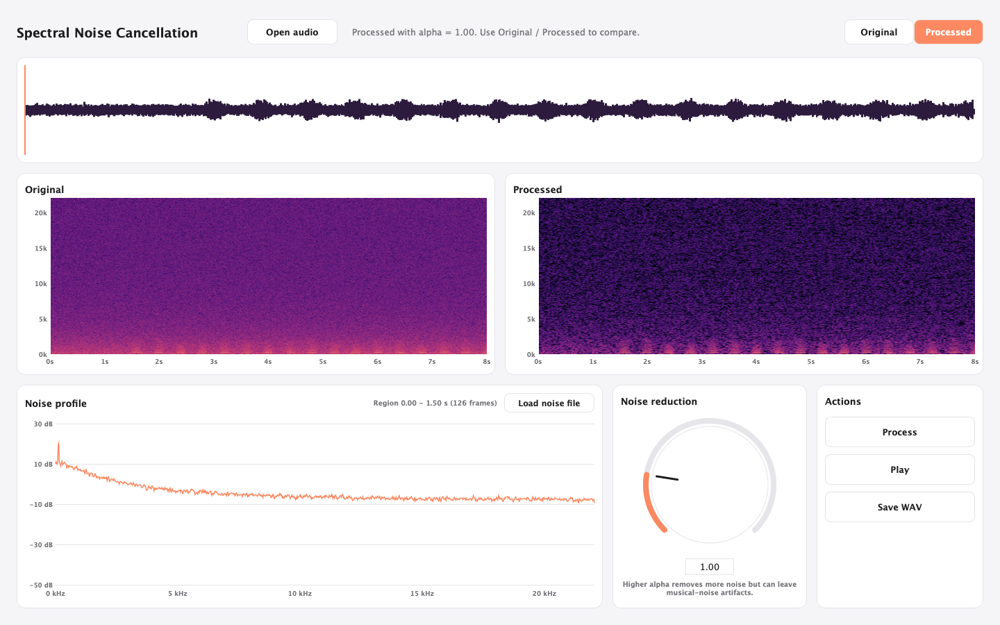

# Spectral Noise Cancellation: Report

A standalone JUCE 8 application that removes steady background noise from a recording using a noise
profile and magnitude spectral subtraction. Processing is offline, built on `juce::dsp::FFT`.

> **To finish before submitting:** the place marked **[TODO]** needs something only a person at the machine can
> supply: listening notes (§8.3). Figure 1 (§8.1) is rendered by the app itself, so replace it with a real
> desktop screenshot if your marker expects one. Every number in
> this report comes from the unit-test log (`SNC_Tests`) and can be reproduced with the commands in §8.

---

## 1. Introduction

Steady noise (fan, hiss, mains hum) has a spectrum that barely changes over time, while speech and music
do. If we know the *average magnitude* of the noise at each frequency, we can subtract it from every
short-time spectrum of the recording and keep the original phase. The pipeline is:

1. Estimate the noise profile D̄v(k) from a noise-only region or a separate noise file.
2. Cut the input into overlapping windowed frames and take the FFT of each: X(m,k).
3. Subtract α·D̄v(k) from |X(m,k)|, clamp at 0, and turn the result into a per-bin gain G(m,k).
4. Multiply the complex bin by G, so the phase is unchanged: Y = G·X.
5. Inverse FFT, synthesis window, overlap-add and normalise to rebuild the waveform.

The one user parameter is the subtraction factor α (default 1.0, range 0 to 5).

## 2. STFT and why overlapping windowed frames

Speech is not stationary over seconds, but is close to stationary over ~20-50 ms. The short-time Fourier
transform therefore analyses frames of N samples every H samples:

    X(m,k) = Σ_{r=0}^{N-1} x[mH + r] · w[r] · e^{-j2πkr/N},   k = 0 … N/2

Windowing is needed because cutting a frame out abruptly smears every tone across all bins. Overlap
(here 75 %) is needed because the window tapers each frame towards zero at its edges: without overlap the
samples near a frame edge would be almost silenced on resynthesis, and any per-frame modification would
produce audible clicks at the seams. With N/H = 4, every sample is covered by four frames.

The same N, H, window and FFT are used for the noise profile and for the input, so their magnitudes are
directly comparable (code: `FrameProcessor::analyseFrame`). The input is padded with N − H zeros at the
start and enough zeros at the end to complete the last frame, so every real sample is seen by four frames
(`StftConfig::paddedLength`).

## 3. Noise profile estimation

For each noise frame V(m,k), computed exactly like X(m,k):

    Dv(m,k) = |V(m,k)|                       D̄v(k) = (1/M) Σ_{m=1}^{M} Dv(m,k)

`NoiseProfile` accumulates the magnitudes in `double` and divides by M in `finalise()`. Two sources are
supported:

- **Region.** The user drags on the waveform. The selected samples are framed *without* padding, so
  M = 1 + (len − N)/H, and no partly-empty frame lowers the average. A region must contain at least N = 2048
  samples (about 0.05 s at 44.1 kHz; the UI asks for at least ~0.1 s and recommends 0.5 s or more).
- **File.** A separate noise-only recording. It must have the input's sample rate (resampling is out of
  scope); otherwise it is rejected with a message giving both rates.

The profile is magnitude, not power, and has no dB conversion anywhere in the DSP; dB is used only for
drawing. One profile is built per channel; if the noise file has fewer channels than the input, channel 0's
profile is used for the extra channels.

For white noise of standard deviation σ the profile is flat. A Hann-windowed bin is complex Gaussian with
E|V|² = σ²·Σw² = σ²·3N/8, and its magnitude is Rayleigh distributed, so E|V| = σ·√(3N/8)·√π/2. The unit
test confirms this: for σ = 0.1 the measured mean over bins was 2.457 against a predicted 2.456.

## 4. Spectral subtraction, gain and phase preservation

For each frame (code: `SpectralSubtractor::process`):

    Dx(m,k) = |X(m,k)|
    D̂s(m,k) = max(Dx(m,k) − α·D̄v(k), 0)         (negative magnitudes are clamped)
    G(m,k)  = D̂s(m,k) / (Dx(m,k) + ε)             (ε = 1e-10 avoids division by zero)
    Re{Y} = G·Re{X},   Im{Y} = G·Im{X}

Because G is a real, non-negative scalar, |Y| = G·|X| = D̂s (to within ε) and arg Y = arg X: the magnitude
is replaced by the subtracted magnitude while the original phase is kept. The ear is much less sensitive to
phase error than to magnitude error, and the noisy phase is the best available estimate of the clean phase.
A non-finite gain is clamped to 0 (and trips a `jassert` in debug builds, which valid input cannot reach).

α is a trade-off. α < 1 under-subtracts and leaves noise; α > 1 over-subtracts, which removes more noise
but also removes speech bins that are only slightly above the noise, and leaves isolated spectral peaks
that fluctuate from frame to frame ("musical noise").

## 5. Inverse STFT, overlap-add and normalisation

For each modified frame (code: `AudioReconstructor::addFrame`):

1. Bins N/2+1 … N−1 are filled with the complex conjugates of bins N/2−1 … 1, so the real-only inverse
   transform is correct whichever FFT engine JUCE selects (Accelerate on macOS, a fallback, IPP, …).
2. `performRealOnlyInverseTransform` gives the time-domain frame z_m[r].
3. The synthesis window is applied once: numerator[mH + r] += ws[r]·z_m[r].
4. The window product is accumulated: denominator[mH + r] += wa[r]·ws[r].

After the last frame, y[n] = numerator[n] / denominator[n], and only the unpadded region is copied out.
Samples whose denominator is below 1e-6 (only possible in the trimmed padding) are set to 0.

Both windows are the **periodic** Hann w[r] = 0.5 − 0.5·cos(2πr/N). (`juce::dsp::WindowingFunction` produces
the symmetric version, which divides by N − 1.) With the periodic form, wa·ws = Hann² sums to exactly 1.5
at 75 % overlap, and a unit test checks Σwa·ws = 1.5 ± 1e-4 over the whole unpadded region. Dividing by the
accumulated sum is still done explicitly, as the brief requires, so the result stays correct for any window.

**JUCE inverse-FFT scaling.** The convention is not assumed: `AudioReconstructor` measures it at
construction by sending a known random frame through a forward and an inverse transform and fitting the
scale. On this platform (macOS, JUCE 8.0.4) the measured scale is **1.0**: JUCE's inverse already divides by
N, so no extra factor is applied. Had it returned N× the input the code would use 1/N instead.

**Identity test.** With α = 0 we get G ≈ 1, so the whole chain must return its input. The maximum error is
about 3·10⁻⁷ (single-precision rounding) for inputs of 5 000, 10 000 and 44 100 samples. This single test
validates framing, windowing, overlap-add and normalisation together.

## 6. Class design

| Class | Responsibility | Key JUCE types |
|---|---|---|
| `StftConfig` | N, H, bin count, padding and frame counts | none |
| `AudioFileManager` | Load and save audio; format errors and NaN/Inf cleanup; no GUI code | `AudioFormatManager`, `AudioFormatReader`, `WavAudioFormat` |
| `FrameProcessor` | Frame extraction, analysis window, forward FFT | `dsp::FFT` |
| `NoiseProfile` | Accumulates \|V(m,k)\| and averages to D̄v(k) | none |
| `SpectralSubtractor` | Dx, D̂s, G; scales Re and Im of each bin | none |
| `AudioReconstructor` | Inverse FFT, scale check, ws, overlap-add, Σwa·ws normalisation | `dsp::FFT`, `AudioBuffer` |
| `NoiseReductionEngine` | Runs the pipeline per channel; progress and cancel; profile estimation | `std::atomic<bool>`, `AudioBuffer` |
| `Spectrogram` | dB magnitude spectrogram for display only | none |
| `PlaybackController` | Audio device, transport, Original/Processed switching with position kept | `AudioDeviceManager`, `AudioSourcePlayer`, `AudioTransportSource`, `MemoryAudioSource` |
| `MainComponent` and `ui/*` | Layout, controls, views, background jobs | `Component`, `Slider`, `TextButton`, `AudioThumbnail`, `Thread`, `ThreadPool` |

Everything under `Source/dsp` and `Source/io` has no GUI dependency and is compiled into both the app and
the `SNC_Tests` console target. The UI never calls the DSP classes directly on the message thread for
anything slow: file decoding, profile estimation, processing and spectrogram rendering run on background
threads and report back with `MessageManager::callAsync` through a `Component::SafePointer`.

**Equation to code**

| Brief § | Equation | Code |
|---|---|---|
| 4.1 | X(m,k) = Σ x[mH+r] w[r] e^(−j2πkr/N) | `FrameProcessor::analyseFrame`: copy N samples from mH, multiply by `analysisWindow[r]`, zero the rest of the 2N buffer, `performRealOnlyForwardTransform` |
| 4.2 | Dv = \|V\|; D̄v = (1/M) Σ Dv | `NoiseProfile::addFrame` (`std::hypot`), `NoiseProfile::finalise` |
| 4.3 | Dx = \|X\|; D̂s = max(Dx − α D̄v, 0) | `SpectralSubtractor::process` |
| 4.4 | G = D̂s / (Dx + ε) | `SpectralSubtractor::process`, non-finite G becomes 0 |
| 4.5 | Re{Y} = G Re{X}, Im{Y} = G Im{X} | `SpectralSubtractor::process` |
| 4.6 | z = IFFT{Y}; numerator += ws z; denominator += wa ws; y = num/den | `AudioReconstructor::addFrame` / `finalise` |

## 7. Parameter settings

| Setting | Value | Notes |
|---|---|---|
| Sample rate | from the input file (demo: 44.1 kHz) | noise file must match |
| FFT size N | 2048 (order 11) | 46.4 ms at 44.1 kHz |
| Hop size H | 512 | 75 % overlap, 11.6 ms |
| Analysis and synthesis window | periodic Hann | computed manually |
| Bins | N/2 + 1 = 1025 | 21.5 Hz spacing at 44.1 kHz |
| α | default 1.0, range 0 to 5, step 0.05 | double-click the knob to reset |
| ε | 1e-10 | |

Audio is processed offline as 32-bit float. Input samples that are NaN or Inf are replaced by 0 when a file
is loaded (the user is told), and again inside the frame analysis; samples beyond ±1·10⁶ are limited so the
FFT cannot overflow.

## 8. Results

**Reproducing.** `python3 tools/make_test_audio.py` writes the demo files to `TestAudio/`; then build and
run `SNC_Tests` (the "Demo files" test prints the tables below). The demo file `noisy_synthetic.wav` is
8 s of 44.1 kHz mono: 1.5 s of noise alone, then a voice-like harmonic signal (12 harmonics, gliding pitch,
about 2.5 syllables per second) in the same steady noise (low-passed white noise, hiss and 120 Hz hum). Its
signal-to-noise ratio is −0.4 dB. `noise_only.wav` is a separate 3 s clip of the same kind of noise.

### 8.1 Spectrograms

*Figure 1. The application with `noisy_synthetic.wav` loaded, the first 1.5 s selected as the noise region,
and the result processed at the default α = 1.0. The image is rendered offscreen from the application's own
window component after the real load, profile and process steps (it is not a desktop screenshot).*

In the original spectrogram (top left) the noise is an even haze across the whole band, a little brighter at
low frequencies, and the voice-like signal is only faintly visible as periodic bursts below about 2 kHz. In
the processed spectrogram (top right) the haze is darker and mottled: at α = 1.0 part of the noise survives
in any given frame, which is the −10 dB noise-only level in §8.2. The harmonic bursts, about 2.5 per second,
are clearer than in the original. Raising α darkens the background further (in an earlier render at α = 1.8
it was almost black, with a few isolated bright specks) at the cost of more signal damage. Specks like those
look like the isolated residual peaks that cause musical noise (§4); whether they are audible is for the
listening notes in §8.3 to say. The noise profile plot (bottom left) shows a smooth hiss slope falling with
frequency and a narrow peak at the far left, which is the 120 Hz hum; it is estimated from the 0 to 1.5 s
region (126 frames).

### 8.2 Measured behaviour

Unit-test results (all pass):

| Check | Result |
|---|---|
| IFFT scale measured | 1.0 |
| STFT identity, α = 0 | max error 3.6·10⁻⁷ |
| Σ wa·ws over the unpadded region | 1.5 ± 1·10⁻⁴ |
| White-noise profile, σ = 0.1 | mean 2.457 (predicted 2.456); per-bin worst case 24 % |
| Subtracting a noise-only signal, α = 1 | −9.9 dB RMS |
| 1 kHz sine in white noise, α = 1.8 | SNR 6.5 dB to 23.6 dB |
| Heap allocations in the frame loop | 0 over 101 frames; engine count independent of length |
| Save then load, 24-bit | max error 1.2·10⁻⁷ |

The −9.9 dB for noise-only input at α = 1 is not 10 dB or more because bin magnitudes of white noise are
Rayleigh distributed: subtracting only their *mean* leaves E[(R − μ)₊²]/E[R²] ≈ 12.6 % of the energy,
which is −9.0 dB in theory. Only α > 1 removes the rest.

Demo file, SNR against `clean_synthetic.wav` (higher is better), and level of the first 1.5 s (noise only)
relative to the noisy file, with the profile from `noise_only.wav`:

| α | SNR, region profile | SNR, noise-file profile | Noise-only level |
|---|---|---|---|
| 0 (bypass) | −0.4 dB | −0.4 dB | 0 dB |
| 1.0 (default) | 6.5 dB | 6.4 dB | −10 dB |
| 1.8 | 6.0 dB | 6.1 dB | −23 dB |
| 3.0 | 3.4 dB | 3.5 dB | −46 dB |
| 5.0 | 1.5 dB | 1.5 dB | silent |

The two profile sources agree to within 0.15 dB, as they should for stationary noise.

### 8.3 Audible trade-offs

The SNR here is `signal energy / (error energy)`, where error includes both leftover noise and damage to
the signal. It therefore peaks near α = 1 on this synthetic file and falls as α grows, even though the
noise-only level keeps dropping: at higher α the algorithm removes more of the weaker harmonics along with
the noise. The default of 1.0 is where SNR peaked on this particular file. Larger values such as 1.8 give a much quieter
noise-only section (−23 dB against −10 dB) at the cost of a little SNR, so which is better depends on what
the listener prefers; that is for the listening notes below.

**[TODO]** Add listening notes after auditioning with the A/B toggle at α = 1.0, 1.8 and 3.0 on both the
demo file and a real speech recording with fan or hiss noise: how much residual noise is left, whether
musical noise ("bubbling" tones in the gaps) is audible, and where speech starts to sound thin. I have not
listened to the results myself, so none of those observations are claimed here.

## 9. Limitations and possible extensions

- **Stationary noise only.** A single average profile cannot follow noise that changes over time.
- **Musical noise.** Hard subtraction with clamping leaves isolated peaks. Remedies: a spectral floor
  (G ≥ β), smoothing G over time and frequency, or over-subtraction with a floor.
- **Wiener-type gain** G = max(1 − α·D̄v²/Dx², 0)^½ or a decision-directed a-priori SNR estimate would
  suppress less speech for the same noise reduction.
- **Window and frame size** are fixed (N = 2048, H = 512); they could be user-selectable.
- **Offline only.** A real-time mode would need a streaming STFT with fixed latency of N − H samples.
- **Sample rate** of a noise file must match the input; resampling is not implemented.
- **Plugin version.** The DSP classes have no GUI dependency, so they could be wrapped in a VST3/AU plugin.
- **Files over 2³¹ samples** are rejected, and very long files are processed in memory.
