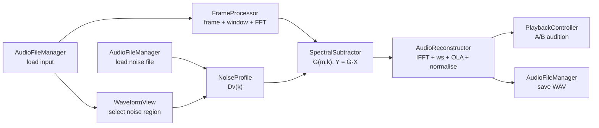

# Implementation Plan — Spectral Noise Cancellation (JUCE Standalone App)

A standalone desktop application that removes steady background noise from a recording using a noise profile and magnitude spectral subtraction, built with JUCE and `juce::dsp::FFT`. **Standalone GUI app only — no VST3 / AU / AAX / plugin targets.**

---

## 1. Scope

### In scope (required by the brief)
- Load a noisy audio file (WAV, AIFF, FLAC, etc. via JUCE's basic formats).
- Select a noise-only region on the waveform **or** load a separate noise-only file.
- Estimate the average noise magnitude spectrum D̄ᵥ(k).
- Offline STFT → magnitude spectral subtraction → gain on complex bins → inverse FFT → overlap-add.
- One user parameter: subtraction factor **α** (rotary knob).
- Audition Original vs Processed (A/B toggle + Play) and save the result as WAV.
- Clear class structure and error handling.

### Out of scope (for now)
- Plugin formats (VST3/AU/AAX), real-time streaming processing, resampling between mismatched sample rates, extra algorithms (Wiener filter, spectral floor β, smoothing). These can be mentioned in the report as possible extensions.

---

## 2. Fixed Processing Settings (use these in the demo and report)

| Setting | Value | Notes |
|---|---|---|
| Sample rate | Taken from the input file (demo: 44.1 kHz) | Noise file must match it |
| FFT size N | 2048 (FFT order 11) | ≈ 46.4 ms at 44.1 kHz |
| Hop size H | 512 | 75% overlap, ≈ 11.6 ms |
| Analysis window wₐ | Periodic Hann | Computed manually, see §6.1 |
| Synthesis window wₛ | Periodic Hann | Same as wₐ |
| Number of bins | N/2 + 1 = 1025 | Bins 0 … N/2 |
| α (default) | 1.8 | Knob range 0.0 – 5.0, step 0.05 |
| ε | 1e-10 | Float magnitudes are O(1e-4 … 1e3) |

The **same** N, H and window are used for noise-profile estimation and for processing the input (brief, Technical Notes).

---

## 3. Technology & Project Setup

- **JUCE 8** (pin a specific 8.x release tag), **C++17**.
- **Build system: CMake** with `juce_add_gui_app` (Projucer "GUI Application" template is an acceptable alternative — just don't add any plugin targets).
- JUCE modules: `juce_core`, `juce_events`, `juce_data_structures`, `juce_graphics`, `juce_gui_basics`, `juce_audio_basics`, `juce_audio_formats`, `juce_audio_devices`, `juce_audio_utils`, `juce_dsp`.

### 3.1 Folder structure

```
Snoise-App/                          // repo root (CMake project: SpectralNoiseCancellation)
├── CMakeLists.txt
├── .gitignore
├── Source/
│   ├── Main.cpp                     // JUCEApplication + DocumentWindow
│   ├── MainComponent.h/.cpp         // wires everything together
│   ├── dsp/
│   │   ├── StftConfig.h             // N, H, window, bin count
│   │   ├── FrameProcessor.h/.cpp    // framing + analysis window + forward FFT
│   │   ├── NoiseProfile.h/.cpp      // accumulate |V(m,k)| → D̄v(k)
│   │   ├── SpectralSubtractor.h/.cpp// subtraction, gain, apply to bins
│   │   ├── AudioReconstructor.h/.cpp// IFFT, synthesis window, OLA, normalise
│   │   └── NoiseReductionEngine.h/.cpp // runs the whole pipeline per channel
│   ├── io/
│   │   └── AudioFileManager.h/.cpp  // load / save, format errors
│   ├── audio/
│   │   └── PlaybackController.h/.cpp// device, transport, A/B switching
│   └── ui/
│       ├── AppLookAndFeel.h/.cpp    // colours, fonts, knob drawing
│       ├── MagmaColourMap.h         // 256-entry Magma lookup table
│       ├── WaveformView.h/.cpp      // waveform + noise region + playhead
│       ├── SpectrogramView.h/.cpp   // STFT image (original / processed)
│       ├── NoiseProfileView.h/.cpp  // D̄v(k) plot + Load noise file
│       ├── NoiseReductionPanel.h/.cpp // α knob
│       └── ActionsPanel.h/.cpp      // Process, Play, Save
├── Tests/
│   └── DspTests.cpp                 // juce::UnitTest suite (console app)
├── TestAudio/                       // noisy_speech.wav, noise_only.wav, etc.
└── docs/
    └── report.md
```

Keep `AudioFileManager` free of GUI code (`FileChooser` lives in the UI layer): it is compiled into the console test target too.

### 3.2 CMakeLists.txt (target state; the scaffold adds sources phase by phase)

```cmake
cmake_minimum_required(VERSION 3.22)
project(SpectralNoiseCancellation VERSION 0.1.0)

include(FetchContent)
FetchContent_Declare(JUCE
    GIT_REPOSITORY https://github.com/juce-framework/JUCE.git
    GIT_TAG        8.0.4)            # pin to the JUCE 8.x tag you install
FetchContent_MakeAvailable(JUCE)

# ---- Shared DSP + IO code (used by app and tests) ----
set(CORE_SOURCES
    Source/dsp/FrameProcessor.cpp
    Source/dsp/NoiseProfile.cpp
    Source/dsp/SpectralSubtractor.cpp
    Source/dsp/AudioReconstructor.cpp
    Source/dsp/NoiseReductionEngine.cpp
    Source/io/AudioFileManager.cpp)

# ---- Standalone GUI app (no plugin targets) ----
juce_add_gui_app(SpectralNoiseCancellation
    PRODUCT_NAME "Spectral Noise Cancellation"
    COMPANY_NAME "YourName")

target_sources(SpectralNoiseCancellation PRIVATE
    Source/Main.cpp
    Source/MainComponent.cpp
    Source/audio/PlaybackController.cpp
    Source/ui/AppLookAndFeel.cpp
    Source/ui/WaveformView.cpp
    Source/ui/SpectrogramView.cpp
    Source/ui/NoiseProfileView.cpp
    Source/ui/NoiseReductionPanel.cpp
    Source/ui/ActionsPanel.cpp
    ${CORE_SOURCES})

target_compile_features(SpectralNoiseCancellation PRIVATE cxx_std_17)
target_compile_definitions(SpectralNoiseCancellation PRIVATE
    JUCE_WEB_BROWSER=0 JUCE_USE_CURL=0
    JUCE_APPLICATION_NAME_STRING="$<TARGET_PROPERTY:SpectralNoiseCancellation,JUCE_PRODUCT_NAME>"
    JUCE_APPLICATION_VERSION_STRING="$<TARGET_PROPERTY:SpectralNoiseCancellation,JUCE_VERSION>")
target_link_libraries(SpectralNoiseCancellation
    PRIVATE juce::juce_audio_utils juce::juce_dsp
    PUBLIC  juce::juce_recommended_config_flags
            juce::juce_recommended_lto_flags
            juce::juce_recommended_warning_flags)

# ---- Unit tests (console app) ----
juce_add_console_app(SNC_Tests PRODUCT_NAME "SNC Tests")
target_sources(SNC_Tests PRIVATE Tests/DspTests.cpp ${CORE_SOURCES})
target_compile_features(SNC_Tests PRIVATE cxx_std_17)
target_compile_definitions(SNC_Tests PRIVATE JUCE_WEB_BROWSER=0 JUCE_USE_CURL=0)
target_link_libraries(SNC_Tests PRIVATE juce::juce_audio_formats juce::juce_dsp
    PUBLIC juce::juce_recommended_config_flags juce::juce_recommended_warning_flags)
```

---

## 4. Architecture

### 4.1 Data flow



`NoiseReductionEngine` owns one `FrameProcessor`, `SpectralSubtractor` and `AudioReconstructor` and runs the loop for each channel. The UI never calls DSP classes directly; it talks to `MainComponent`, which starts jobs on a background thread.

### 4.2 Class responsibilities (matches brief §6)

| Class | Responsibility | Key JUCE types |
|---|---|---|
| `StftConfig` | Holds N, H, window type; computes `numBins`, frame counts | — |
| `AudioFileManager` | Load input/noise files, save output, report format errors | `AudioFormatManager`, `AudioFormatReader`, `WavAudioFormat`, `FileChooser` |
| `FrameProcessor` | Extract frame m, apply wₐ, forward FFT into interleaved complex buffer | `dsp::FFT` |
| `NoiseProfile` | Accumulate \|V(m,k)\| over M frames, compute average | `std::vector<float>` |
| `SpectralSubtractor` | Compute Dx, D̂s, G; scale Re/Im of each bin | — |
| `AudioReconstructor` | Inverse FFT, scaling check, wₛ, overlap-add, Σwₐwₛ normalisation | `dsp::FFT`, `AudioBuffer<float>` |
| `NoiseReductionEngine` | Runs the pipeline per channel, reports progress, supports cancel | `std::atomic<bool>` |
| `PlaybackController` | Audio device, transport, Original/Processed switching | `AudioDeviceManager`, `AudioSourcePlayer`, `AudioTransportSource`, `MemoryAudioSource` |
| `MainComponent` + `ui/*` | Layout, user controls, views | `Component`, `Slider`, `TextButton`, `Image`, `AudioThumbnail` |

### 4.3 Header sketches

```cpp
// StftConfig.h
struct StftConfig
{
    int fftOrder = 11;                       // N = 2048
    int hopSize  = 512;                      // H
    int fftSize() const  { return 1 << fftOrder; }
    int numBins() const  { return fftSize() / 2 + 1; }
    int paddedLength (int numSamples) const; // + (N - H) front, + end padding to fill last frame
    int numFrames (int paddedLength) const;  // 1 + (paddedLength - N) / H (padded length, not raw)
};

// FrameProcessor.h
class FrameProcessor
{
public:
    explicit FrameProcessor (const StftConfig&);
    // Copies x[mH + r]·wa[r] into fftData (size 2N), runs forward FFT.
    void analyseFrame (const float* signal, int numSamples, int frameIndex, float* fftData);
    const std::vector<float>& getAnalysisWindow() const;
private:
    StftConfig config;
    juce::dsp::FFT fft;
    std::vector<float> analysisWindow;       // periodic Hann
};

// NoiseProfile.h
class NoiseProfile
{
public:
    void reset (int numBins);
    void addFrame (const float* fftData);    // adds |V(m,k)| for each k
    void finalise();                         // divides by M
    bool isReady() const;
    int  getFrameCount() const;              // M
    const std::vector<float>& getAverageMagnitude() const; // D̄v(k)
private:
    std::vector<double> sum;                 // double accumulator
    std::vector<float>  average;
    int frameCount = 0;
};

// SpectralSubtractor.h
class SpectralSubtractor
{
public:
    void setAlpha (float newAlpha);          // clamped to [0, 5]
    void setEpsilon (float newEpsilon);      // default 1e-10f
    void process (float* fftData, const NoiseProfile&, int numBins) const;
private:
    float alpha = 1.8f, epsilon = 1.0e-10f;
};

// AudioReconstructor.h
class AudioReconstructor
{
public:
    AudioReconstructor (const StftConfig&, std::vector<float> analysisWindow);
    void prepare (int paddedLength);
    void addFrame (float* fftData, int frameIndex); // IFFT, ·ws, accumulate
    void finalise (float* output, int startOffset, int numSamples); // divide by Σwa·ws
private:
    StftConfig config;
    juce::dsp::FFT fft;
    std::vector<float> analysisWindow, synthesisWindow;
    std::vector<float> numerator, denominator;
    float ifftScale = 1.0f;                  // set by round-trip check, §6.4
};

// NoiseReductionEngine.h
class NoiseReductionEngine
{
public:
    using Progress = std::function<void (float)>;   // 0..1
    juce::Result estimateProfile (const juce::AudioBuffer<float>& noise,
                                  std::vector<NoiseProfile>& profilesOut);
    juce::Result process (const juce::AudioBuffer<float>& input,
                          const std::vector<NoiseProfile>& profiles,
                          float alpha,
                          juce::AudioBuffer<float>& output,
                          Progress progress,
                          const std::atomic<bool>& shouldCancel);
};
```

---

## 5. Equation → Code Mapping

| Brief § | Equation | Where | Implementation |
|---|---|---|---|
| 4.1 | X(m,k) = Σ x[mH+r] w[r] e^(−j2πkr/N) | `FrameProcessor::analyseFrame` | copy N samples from `mH`, multiply by `analysisWindow[r]`, zero the rest of the 2N buffer, `fft.performRealOnlyForwardTransform(data, true)` |
| 4.1 | V(m,k) (noise) | same function, noise buffer | identical settings so units match |
| 4.2 | Dv(m,k) = \|V(m,k)\| | `NoiseProfile::addFrame` | `std::hypot(re, im)` per bin k = 0…N/2 |
| 4.2 | D̄v(k) = (1/M) Σ \|V(m,k)\| | `NoiseProfile::finalise` | `average[k] = sum[k] / M` |
| 4.3 | Dx(m,k) = \|X(m,k)\| | `SpectralSubtractor::process` | `std::hypot(re, im)` |
| 4.3 | D̂s = max(Dx − α D̄v, 0) | `SpectralSubtractor::process` | `std::max(Dx - alpha * Dv[k], 0.0f)` |
| 4.4 | G = D̂s / (Dx + ε) | `SpectralSubtractor::process` | guard: if result is not finite → `G = 0` |
| 4.5 | Re{Y} = G Re{X}, Im{Y} = G Im{X} | `SpectralSubtractor::process` | `data[2k] *= G; data[2k+1] *= G;` |
| 4.6 | zₘ[r] = IFFT{Y(m,k)} | `AudioReconstructor::addFrame` | mirror conjugate bins, `performRealOnlyInverseTransform`, apply `ifftScale` |
| 4.6 | numerator += wₛ[n−mH] zₘ[n−mH] | `AudioReconstructor::addFrame` | do **not** apply wₐ again |
| 4.6 | denominator += wₐ[n−mH] wₛ[n−mH] | `AudioReconstructor::addFrame` | accumulated per sample |
| 4.6 | y[n] = numerator / denominator | `AudioReconstructor::finalise` | if denominator < 1e-6 → `y = 0` (padding only) |

Per-bin loop in `SpectralSubtractor::process`:

```cpp
for (int k = 0; k < numBins; ++k)
{
    float& re = fftData[2 * k];
    float& im = fftData[2 * k + 1];
    const float Dx  = std::hypot (re, im);                         // |X(m,k)|
    const float Ds  = std::max (Dx - alpha * Dv[k], 0.0f);         // D̂s(m,k)
    float G = Ds / (Dx + epsilon);                                 // G(m,k)
    if (! std::isfinite (G)) G = 0.0f;
    re *= G;                                                       // Re{Y}
    im *= G;                                                       // Im{Y}
}
```

---

## 6. JUCE-Specific Details and Pitfalls

### 6.1 Window
`juce::dsp::WindowingFunction` produces a **symmetric** Hann (divides by N−1). Compute a **periodic** Hann yourself so that Hann² at 75% overlap sums to a constant (1.5):

```cpp
for (int r = 0; r < N; ++r)
    w[r] = 0.5f - 0.5f * std::cos (juce::MathConstants<float>::twoPi * r / N);
```

The Σwₐwₛ normalisation would correct a symmetric window as well, but periodic Hann is the textbook choice and simpler to explain in the report.

### 6.2 FFT buffer layout
- `juce::dsp::FFT fft (11);` → size N = 2048.
- Real-only transforms need a float array of **2N** elements.
- After `performRealOnlyForwardTransform (data, true)`, bin k is at `data[2k]` (Re) and `data[2k+1]` (Im) for k = 0 … N/2.
- Allocate all buffers once (`std::vector<float>(2 * N)`); never allocate inside the frame loop.

### 6.3 Inverse transform input
Before `performRealOnlyInverseTransform`, fill the negative-frequency bins as complex conjugates (`X[N−k] = conj(X[k])` for k = 1 … N/2−1). This keeps the code correct regardless of which FFT engine JUCE picks on your platform (fallback, Accelerate on macOS, IPP, etc.).

### 6.4 Inverse FFT scaling (brief §4.6)
JUCE's inverse transform applies its own scaling; don't assume — **measure it**. In `AudioReconstructor`'s constructor (and in a unit test), run one frame of a known signal through forward + inverse:
- If the result equals the input → `ifftScale = 1.0f`.
- If it is N× larger → `ifftScale = 1.0f / N`.

Document the observed behaviour in the report; this answers the brief's "account for JUCE's inverse-FFT scaling convention".

### 6.5 Frame boundaries and padding
- Pad the input with **N − H zeros at the start** and enough zeros at the end to complete the last frame plus N − H. Every real sample is then covered by N/H = 4 frames.
- Number of frames: `M = 1 + (paddedLength − N) / H` (rounded up via end padding).
- After overlap-add, copy back only the original-length region (skip the front padding).
- Denominator guard: any sample with Σwₐwₛ < 1e-6 is set to 0 (this only happens in the trimmed padding).

### 6.6 Units consistency
Noise and input both use: same N, same window, same FFT, magnitude (not power), no dB conversion inside the DSP. dB is used **only** for drawing (spectrogram, profile plot).

### 6.7 Multichannel
Process each channel independently with its own noise profile from the same region. If the noise file has fewer channels than the input, reuse channel 0's profile for all channels.

---

## 7. Application Behaviour

### 7.1 Threading
- File loading, profile estimation and processing run on a background `juce::Thread` (or a `juce::ThreadPool` job).
- Progress and completion return to the message thread through `juce::MessageManager::callAsync` with a `Component::SafePointer`.
- While processing: disable Process, Load and the α knob; Process reads "Processing… 66%". A cancel flag (`std::atomic<bool>`) is checked every frame.
- Processing is **offline**: changing α marks the result as stale (Process button highlighted again); the user reprocesses. A 23 s mono file at N = 2048 is ~2,000 frames, which should finish in well under a second.

### 7.2 Playback and A/B
- `AudioDeviceManager` (default output) → `AudioSourcePlayer` → `AudioTransportSource` → `MemoryAudioSource` wrapping either the original or processed buffer.
- The A/B toggle swaps the source while keeping the playback position.
- A 30 Hz `juce::Timer` moves the playhead on the waveform and spectrogram.
- Processed is disabled until a result exists.

### 7.3 Saving
`FileChooser::launchAsync` → `WavAudioFormat::createWriterFor` at the input sample rate, 24-bit by default. Check the output peak first; if it exceeds 1.0 (uncommon, but overlap-add of modified frames can overshoot slightly), warn and offer to normalise.

---

## 8. Error Handling

| Situation | Handling |
|---|---|
| Unsupported / corrupt file | `AudioFileManager` returns `juce::Result::fail("…")`; UI shows `AlertWindow::showMessageBoxAsync` |
| Empty or zero-length file | Reject with message |
| Noise region or noise file shorter than N samples (M = 0) | "Select at least ~0.1 s of noise (≥ 2048 samples)"; recommend ≥ 0.5 s |
| Noise file sample rate ≠ input sample rate | Reject: "Noise file must use the same sample rate as the input" |
| Process pressed with no input / no profile | Button disabled; tooltip explains why |
| NaN/Inf in the input | Detect after loading; replace with 0 and warn |
| Non-finite gain or output sample | Clamp to 0 inside the DSP (§5) and `jassert` in debug builds |
| Audio device fails to open | Show the error; processing and saving still work |
| Save fails (permissions, disk) | Writer returns nullptr → error dialog |

---

## 9. User Interface (matches the approved mockup)

Window ≈ 1440 × 900, resizable with a minimum size. Light theme, white cards, 12 px corner radius, one accent colour.

| Component | JUCE implementation | Purpose |
|---|---|---|
| A/B toggle (top right) | Two `TextButton`s in a radio group | Switch Original / Processed |
| `WaveformView` | `AudioThumbnail` + `AudioThumbnailCache`; mouse drag creates the noise region | Find and mark the noise-only section |
| `SpectrogramView` | `juce::Image` (frames × bins), filled from 20·log10(\|X\|/Σwₐ + 1e-9) (magnitude normalised by the window sum so a full-scale sine ≈ 0 dB; drawing only) mapped −90…0 dB → Magma LUT; two images (original, processed) | Show noise haze before and its removal after |
| `NoiseProfileView` | Custom `paint()` path of 20·log10(D̄v(k)), x = frequency, y = dB; `TextButton` "Load noise file" | Confirm the profile looks sensible |
| `NoiseReductionPanel` | `Slider` (RotaryHorizontalVerticalDrag), range 0–5, step 0.05, default 1.8, custom `drawRotarySlider` | The α parameter |
| `ActionsPanel` | `TextButton` Process (filled), Play, Save (outlined) | Run, audition, export |

`AppLookAndFeel` (subclass of `LookAndFeel_V4`) colours:

| Token | Hex |
|---|---|
| Window background | `#F5F5F7` |
| Card | `#FFFFFF` |
| Border | `#E5E5EA` |
| Primary text | `#1D1D1F` |
| Secondary text | `#6E6E73` |
| Accent (magma orange) | `#FC8961` |
| Waveform | `#2D1B3D` |

Spectrogram image is computed on the background thread after processing, then handed to the view.

---

## 10. Testing

### 10.1 Unit tests (`Tests/DspTests.cpp`, `juce::UnitTest`)
1. **FFT round trip**: forward + inverse of a random frame returns the input (max error < 1e-5). Records the IFFT scale.
2. **STFT identity**: α = 0 → G ≈ 1 → full pipeline output ≈ input (max error < 1e-4). *This single test proves framing, windowing, OLA and normalisation are correct.*
3. **Window normalisation**: Σwₐwₛ is constant (1.5) across the unpadded region.
4. **Noise profile**: white noise of known RMS gives a flat D̄v(k) within tolerance; M equals the expected frame count.
5. **Subtraction on noise only**: α = 1 on the same noise → output RMS drops by at least 10 dB.
6. **SNR improvement**: 1 kHz sine + white noise; SNR after processing is higher than before.
7. **Edge cases**: input shorter than N, silent input (all zeros → no NaN), stereo input.
8. **Error paths**: noise region/file shorter than N is rejected (M = 0); noise file with a different sample rate is rejected; NaN/Inf input is sanitised.

### 10.2 Manual tests
- Load speech + fan/hiss noise, select the first 1–2 s, process at α = 1.0, 1.8, 3.0 and listen for residual noise vs musical noise.
- A/B switching during playback, save and reopen the WAV in a DAW or Audacity, compare spectrograms.
- Try every error case in §8.

---

## 11. Milestones

Each phase ends with something that runs.

| # | Phase | Deliverable / acceptance check | Rubric link |
|---|---|---|---|
| 0 | Project setup | Empty JUCE GUI window builds and opens via CMake; test target builds | Code structure |
| 1 | File I/O + playback | Load a file, see the waveform, play it, save it unchanged | Functionality |
| 2 | STFT engine | `FrameProcessor` + `AudioReconstructor`; tests 1–3 pass (identity) | DSP correctness |
| 3 | Noise profile | Region selection + "Load noise file"; D̄v(k) plotted; test 4 passes | DSP correctness, Functionality |
| 4 | Spectral subtraction | `SpectralSubtractor` + `NoiseReductionEngine` on a background thread; tests 5–7 pass; audible result | DSP correctness |
| 5 | UI completion | Spectrogram (original/processed), α knob, A/B toggle, LookAndFeel matching the mockup | Functionality, Code/JUCE use |
| 6 | Robustness | All §8 errors handled; no NaN; no allocations in the frame loop | Code/JUCE use |
| 7 | Report + demo | Report written, demo video recorded (§12) | Report & demonstration |

Recommended order of risk: get Phase 2 (identity test) right before touching subtraction. Most bugs in STFT apps are in framing and overlap-add, not in the subtraction itself.

---

## 12. Report and Demonstration Checklist

### Report outline (`docs/report.md`)
1. Introduction: problem and method.
2. STFT and why overlapping windowed frames are used.
3. Noise profile estimation (§4.2) — region vs file.
4. Spectral subtraction, gain and phase preservation (§4.3–4.5).
5. Inverse STFT, overlap-add, Σwₐwₛ normalisation, JUCE IFFT scaling (§4.6, §6.4).
6. Class design — table from §4.2 and the equation mapping from §5.
7. Parameter settings — table from §2.
8. Results — before/after spectrograms, α comparison, audible trade-offs (residual noise, musical noise, speech damage at high α).
9. Limitations and possible extensions (spectral floor, smoothing, Wiener filter, real-time mode, plugin version).

### Demo video
- [ ] Load the noisy file and play the original.
- [ ] Drag-select the noise region (or load a noise file) and show the profile.
- [ ] State: **N = 2048, H = 512 (75% overlap), periodic Hann analysis and synthesis, α = 1.8**.
- [ ] Process; show the processed spectrogram.
- [ ] A/B switch during playback.
- [ ] Briefly show α = 3.0 to demonstrate musical-noise artefacts.
- [ ] Save as WAV.
